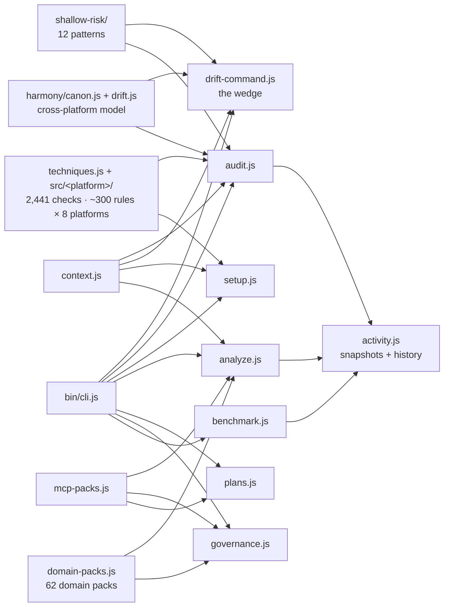

# Architecture

Two entrypoints sit on the same engine. `nerviq drift` is the wedge — three
deterministic layers, no score, lint semantics. `nerviq audit` is the full
governance surface — 2,441 checks across 8 platforms, scored 0-100.

## Data Flow



## Module Responsibilities

| Module | Role | I/O |
|--------|------|-----|
| **context.js** | Scans project directory, caches file reads | Dir path → ProjectContext |
| **drift-command.js** | The wedge: stale refs + permission exposure + Harmony drift. Exit 1 on findings, no score | Dir → findings + exit code |
| **techniques.js** + `src/<platform>/techniques.js` | The knowledge base: ~300 governance rules per platform, every check carrying `sourceUrl` and `confidence` | ProjectContext → check results |
| **shallow-risk/** | 12 deterministic agent-config ↔ codebase patterns. Four (secrets, auto-approve, MCP allowlist, missing hook) run default-on in `drift` | ProjectContext → findings |
| **harmony/canon.js** | Builds one canonical model of instructions, MCP servers, trust posture and rules across all 8 platforms | Dir → canonical model |
| **harmony/drift.js** | Detects instruction gaps, **contradictions**, trust drift, MCP drift, rule drift, coverage gaps | Canonical model → drifts + score |
| **audit.js** | Runs checks, calculates score, builds topNextActions | Options → scored result |
| **freshness.js** + `src/<platform>/freshness.js` | P0 source inventory with per-source staleness thresholds (14/30d) | — → release gate |
| **analyze.js** | Augment/suggest-only analysis with strengths, gaps, domains | Options → analysis report |
| **plans.js** | Generates proposal bundles, applies with rollback | Audit result → proposals |
| **setup.js** | Generates CLAUDE.md, hooks, commands, agents, skills, rules | Stacks + context → files |
| **governance.js** | Permission profiles, hook registry, policy packs | Config → governance summary |
| **benchmark.js** | Isolated before/after in temp copy | Options → benchmark report |
| **domain-packs.js** | Detects repo type from signals | Context + stacks → domain matches |
| **mcp-packs.js** | Recommends MCP servers per domain | Domains + signals → MCP packs |
| **activity.js** | Snapshots, history, compare, trend export | Payloads → artifact files |
| **doctor.js** | Self-diagnostics: env, platforms, freshness gates, catalog provenance, MCP, hooks | Dir → diagnostic report |

## The wedge layers (`nerviq drift`)

| Layer | What it proves | Ecosystems |
|-------|----------------|-----------|
| Stale references | The doc names a script/task/version the repo does not have | npm/pnpm/yarn/bun · Makefile · justfile · Taskfile · composer · rake · tox · cargo-make · go.mod · Cargo.toml · pyproject · requirements.txt · Gemfile · .nvmrc |
| Permission & exposure | The agent is allowed more than the team thinks | secrets in agent config · auto-approved destructive rules · MCP servers with no allowlist · hooks pointing at missing scripts |
| Cross-platform drift | Two platforms give the agent different — or opposite — orders | instruction gaps · package-manager / version / language / policy contradictions · trust-posture gaps |

## Scoring

```
Score = (earned / max) * 100

Weights: critical=15, high=10, medium=5, low=2
Organic score: excludes checks that nerviq itself generated
```

Checks return `true` (pass), `false` (fail), or `null` (not applicable / skip).

## Trust-First Flow

```
User runs audit → sees score + gaps
            ↓
User runs plan → sees file previews + rationale
            ↓
User reviews → approves specific bundles
            ↓
apply writes files → rollback manifest created
            ↓
User runs audit again → sees improvement
```

No step writes without the previous step's output being reviewed.
